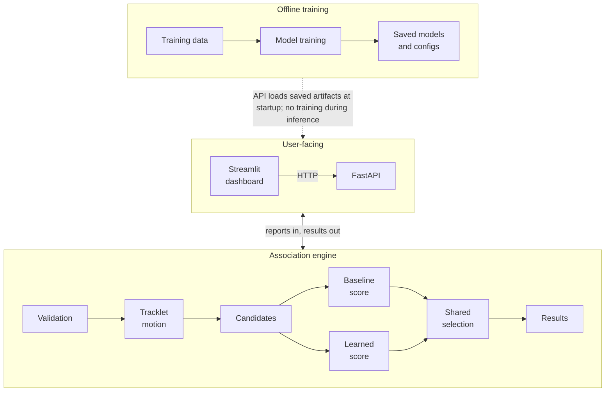
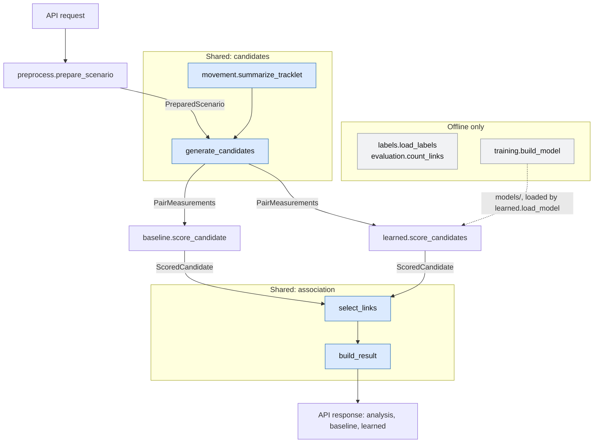

# Architecture

## 1. System at a glance

Aircraft paths arrive as disconnected fragments called tracklets. For each tracklet, the system finds the immediate next tracklet from the same aircraft, or leaves it unresolved.

The hard part is that nearby aircraft fly similar paths, and a link that skips a fragment extrapolates almost as well as the true link, yet counts as wrong. A wrong link also costs more than an unresolved one.

Design goals: deterministic results, no labels in inference, every decision explained by measurements, and abstention when the evidence doesn't separate candidates.

## 2. High-level architecture



Baseline and learned scoring are parallel branches over the same candidates and the same selection, which keeps the comparison fair. Results return through the API to the dashboard as JSON, one result per method.

Training is a separate command. The API only loads saved artifacts, once at startup, and never trains. The dashboard contains no inference code. It reads supplied records through the API, and posts them back for analysis.

## 3. How association works

1. **Load.** The dashboard fetches a scenario's raw rows. Names are matched exactly against folders found at startup, and only train, validation and staged data are served.
2. **Validate.** `prepare_scenario` rejects schema violations, bad coordinates or timestamps, conflicting IDs, and records received after the snapshot's cutoff. Identical duplicates collapse. Reports are ordered by `observed_at`, the measurement time; `received_at` decides only when evidence became available.
3. **Fit motion.** `summarize_tracklet` fits a robust line through position and altitude, so one bad report barely moves it.
4. **Generate candidates.** `generate_candidates` pairs A with each B that starts strictly after A ends, within one scenario, and keeps those with gap ≤ 600 s, implied speed ≤ 1,100 km/h and position miss ≤ 5 km. Each pair gets a `PairMeasurements`, where `None` means "couldn't be measured".
5. **Score.** Higher is more plausible for both, but the scales differ and are never compared.
   - Baseline: minus the sum of squared, noise-scaled residuals for position and projected altitude. 0 is best, with no lower bound.
   - Learned: an uncalibrated classifier score from 0 to 1. It isn't a probability of being correct, and true links across long gaps score low because they resemble skips.
6. **Select.** `select_links` withholds A → C when some B makes A → B and B → C both plausible. It then accepts pairs from best to worst, only if the score clears the minimum, both ends are free, and the pair leads every remaining rival by the margin. A pair that fails stays a rival, so a close contest leaves both sides unresolved.
7. **Report.** `build_result` checks the invariants and returns each tracklet's status, successor, ranked candidates, measurements and reason, with the input fingerprint, version and policy.
8. **Display.** The dashboard plots the raw reports with accepted links and competing candidates, and shows both methods' decisions and the original records.

**Staged evidence.** Each snapshot is a complete input, analysed separately with the same models and settings. Only the outputs are compared.

```text
Snapshot 1:  A → C
Snapshot 2:  A → B → C     (delayed fragment B arrives inside the gap)
```

New evidence changes the immediate successor of A, not the inferred aircraft. Both results are correct for their own snapshot.

## 4. Low-level design



| Module | Responsibility |
|---|---|
| `schema`, `preprocess`, `loader` | Validate records, dedupe, order, join supporting records, read files |
| `movement`, `candidates` | Motion fits, candidate pairs, gates and measurements |
| `baseline`, `learned` | One `analyze` each, with the same shape of result. Only the score differs |
| `association` | Selection, invariants and the result contract. It knows nothing about scoring |
| `api` | `create_app`, startup loading, routes and errors |
| `training`, `labels`, `evaluation` | Fitting, labels and metrics. Reached only from scripts, and never imported by inference |

**Model loading.** `create_app` loads everything once at startup. A failure doesn't stop the server: it's logged, and `/health` and inference return 503 naming the problem. The API refuses a model saved under a different scikit-learn before unpickling it. `load_model` also checks the artifact's hash and feature schema, and `load_policy` refuses thresholds selected for another model.

**Contract.** `POST /tracklets/associate` rejects unknown fields, so labels can't be sent. Rows stay raw JSON for the validators, which keeps missing distinct from null. Every error has the shape `{"error": {"code", "message", "issues"}}`: 400 for invalid JSON, 422 for invalid or conflicting input, 404 and 405, 503 when models are unavailable, and 500 with no internal details.

## 5. Design decisions and trade-offs

| Decision | Why we chose it | Trade-off |
|---|---|---|
| Loose physical gates; altitude never gates | A pair removed here can't be recovered. The gates kept every true link on train, validation and test, and cut train pairs from 15,912 to 5,570 | More candidates to score, and more rivals for selection to resolve |
| Both a rule-based baseline and a learned model | Shared candidates and selection make them comparable. The baseline is easy to explain, and the model copes better with missing altitude. They tie on clean test data: 338 of 339, 0 wrong | Neither wins everywhere. The model is weak on long gaps, and needs physical limits (3 km, 15°) beside its score, because training data holds no geometry that far off |
| Greedy selection, not global assignment | Deterministic and easy to trace, with a skip guard and rival margin. A one-off development comparison found no wrong links for either method, and few extra links from assignment | An early wrong link can't be undone. A withheld A → C also stops being a rival, so a much weaker A → B can be accepted |
| Abstain rather than risk a wrong link | Thresholds minimize `5 × wrong + missed`, an assumed ratio. Wrong links also count at the next-lower margin, so no setting sits beside one that errs | True links stay unresolved. The margin can't help when true successors are absent: at the visible-window stress the baseline makes 37 wrong links on train and 10 on validation (learned: 8 and 0) |
| Score altitude, and handle its absence explicitly | It's the strongest separator of nearby aircraft. It's projected across the gap, missing adds a penalty in the baseline, and the model trains on altitude-hidden copies of each row | Dependence remains. With altitude removed, test recall falls to 0.823 (baseline, 0 wrong) and 0.926 (learned, 2 wrong). 300 ft of noise causes wrong links in both |

FastAPI and Streamlit keep this local, with no build step, database or map provider, and leave validation in one place. The cost is that Streamlit's rerun model limits interaction: plot zoom may reset on selection.

**Signals.** Only documented time, position and altitude are used to associate. Reported speed and course are excluded because derived motion exists, and 2–6% of speed readings are over 50% off. `ref` and `tag` agree on only about 51% of true links, and different aircraft sharing a value were all plausible matches, so they mislead on the hard cases. `q` means different things by feed, `a1` is redundant altitude, and telemetry-x `spd`, `rx`, `r7`, `node` and `b4` stayed unresolved.

**Difficult test cases**, from `reports/test_evaluation.json`:

- The baseline misses `e314d8ed` → `420b7e72` (gap 329 s): another aircraft's fragment passes its loose plausibility limit, so the skip guard withholds the true link. Learned accepts it.
- Learned misses `09f3c575` → `e3667266` (gap 377 s, longer than any true training link): it scores 0.002 and abstains. The baseline accepts it.
- With altitude removed, `6c2695b9` and `cb4b4ac8` have four near-identical pairings. Learned takes the strongest and is forced into a swap; the baseline leaves both unresolved.

## 6. Reliability and reproducibility

- **Determinism.** `input_fingerprint` and results don't change with row order or identical retransmissions. IDs break ties for ordering only.
- **Duplicates and conflicts.** Comparison uses parsed JSON: key order is ignored, and missing differs from null. A repeated ID with different content rejects the whole input and names the ID.
- **Label isolation.** Inference modules don't load `labels`, which fresh-interpreter tests confirm. Responses contain no labels, and the API doesn't serve the test partition.
- **Frozen settings.** Scales and the model are fitted on train, and thresholds selected on validation with ties broken on train. `scripts/final_test_evaluation.py` checks hashes in `reports/freeze_manifest.json` first, and refuses to overwrite the first result.
- **Versioning.** Baseline and model versions are hashes of their settings, plus the training data for the model. Each result records them. Retraining reproduces the saved model byte for byte on the pinned versions.
- **Snapshot cutoffs.** `prepare_scenario` refuses any record whose `received_at` is after the cutoff, and no features are computed across snapshots.
- **Tests.** Unit tests check inputs and geometry against independently known values, and selection and metrics against worked examples. `tests/test_e2e.py` runs real servers on real data. `scripts/mutation_check.py` injects known bugs to confirm that the tests catch them.
